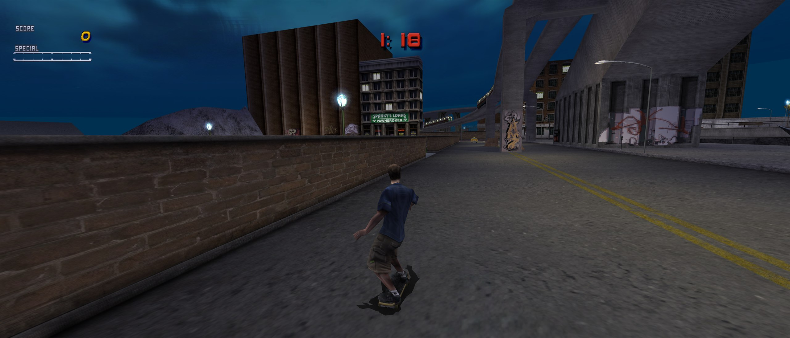
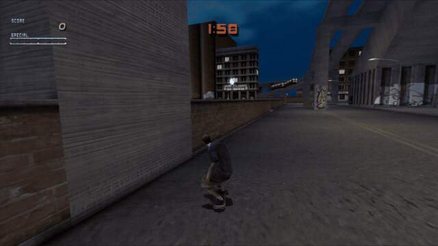
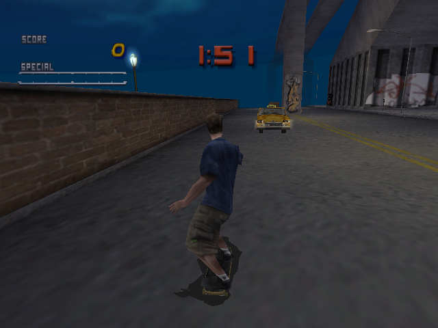
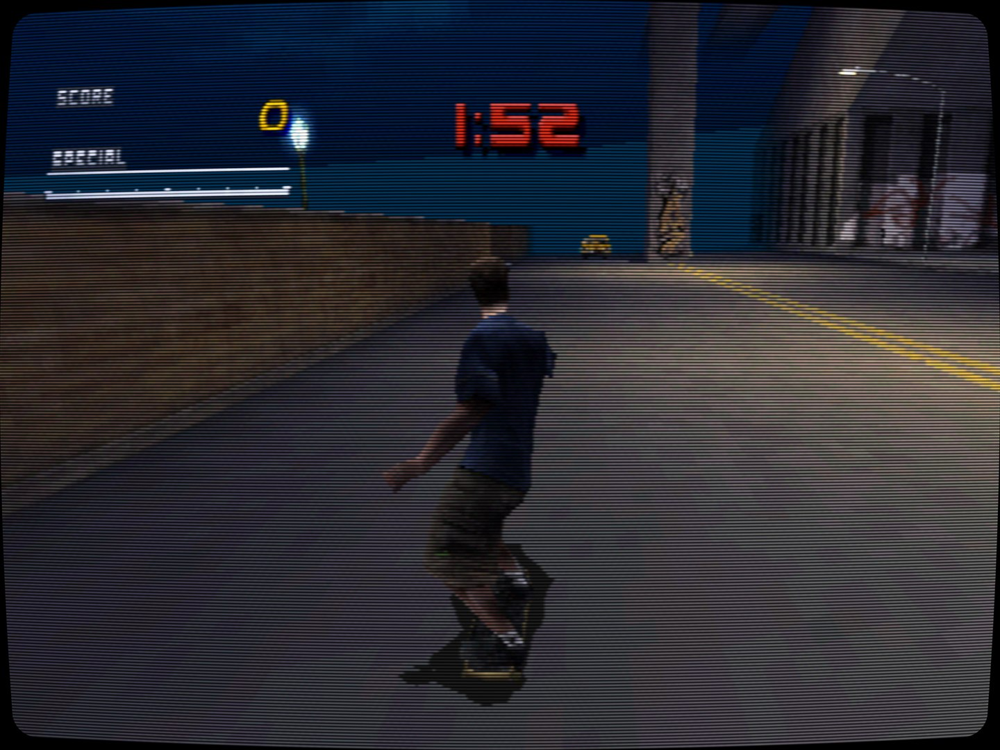
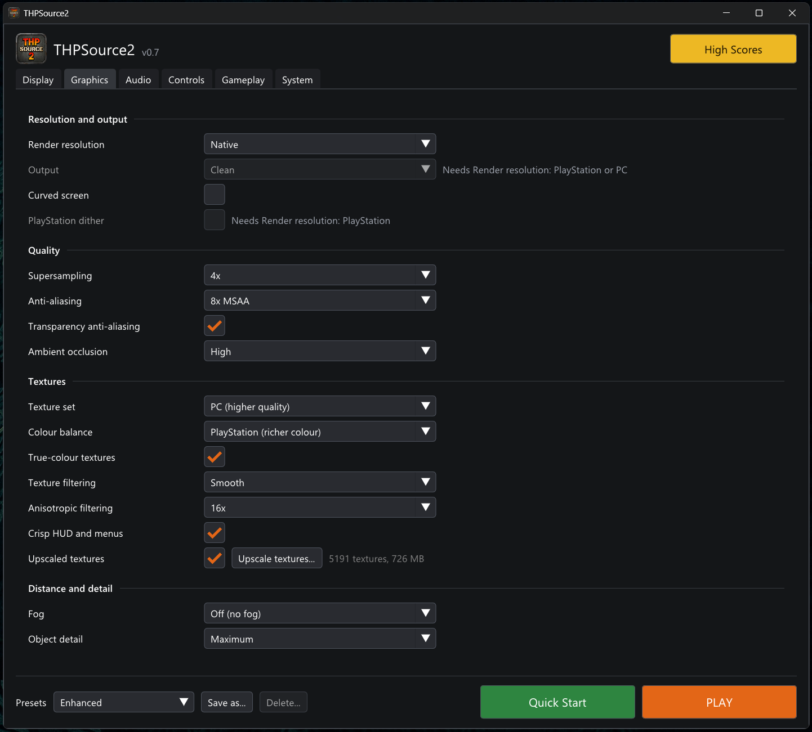
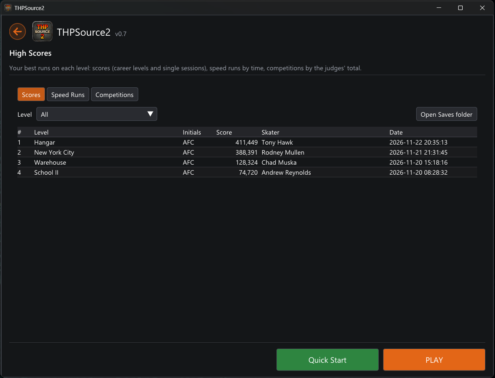
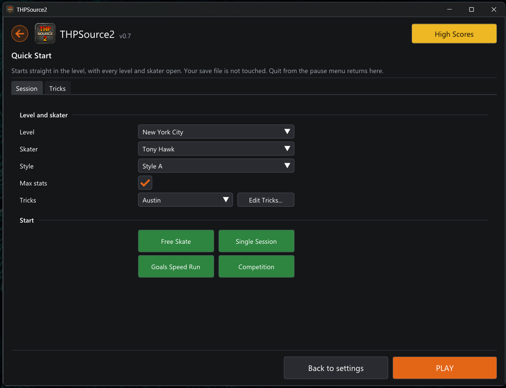

# THPSource2

-blue)

**A full decompilation of Tony Hawk's Pro Skater 2 rebuilt into a native modern game** [x32|PC|2000] → [x64|PC|Portable]. Any resolution or aspect ratio, up to 120fps, unlimited draw distance, texture upscaling, new game modes and much more. Bring your own copy of the game.

*Enhanced preset: 4K, up to 120 fps, upscaled textures, 21:9 ultrawide, no fog, unlimited draw distance, and a matching field of view and HUD scale.*

*Free camera in action: swing the view around your skater with the second stick, mid-run. Recorded in the Enhanced preset 16:10, then shrunk to 640 px and 15 fps for this page.*

**[Download the latest release](https://github.com/afcurtis/THPSource2/releases/latest)** · Windows 10/11, 64-bit

> **No game files are included.** You need your own copy of the PC game. THPSource2 is a fan project, not affiliated with or endorsed by
> Activision, Neversoft or Tony Hawk. Tony Hawk's Pro Skater is a trademark of Activision.

## The originals, your way

<table>
<tr>
<td width="50%"></td>
<td width="50%"></td>
</tr>
<tr>
<td><em>Original PC preset: 640×480, 30 fps, fog, 4:3.</em></td>
<td><em>Original PlayStation preset: 512×240, 30 fps, fog, 4:3 with a curved CRT filter.</em></td>
</tr>
</table>

Same spot, same skater. Both originals are presets in the launcher, so you can still play it exactly the way it was. Every setting can be tweaked, so
you can also keep the look you love and add what you want: a higher frame rate, widescreen, the PlayStation's CRT screen on its own, or anything in between.

## What you get

- **Up to 120 fps, physics decoupled across the board.** Skating, timers and the world all run at the game's own speed, whatever the
  frame rate.
- **Unlimited draw distance.** No fog and no pop-in: the whole level is in view, all the time.
- **Any resolution, any aspect ratio.** Widescreen and ultrawide with the field of view to match.
- **It has never looked better.** Supersampling, anti-aliasing, ambient occlusion and anisotropic filtering.
- **Textures in full colour.** The game's textures are 24-bit pictures that the original cut down to 15-bit colour. THPSource2 draws them
  as they are, and can AI-upscale them from those 24-bit sources on your own PC with one button.
- **Free camera.** Swing the camera round your skater with the second stick, like the later THPS games.
- **Modern controllers, natively.** Xbox and other pads work with no setup; rebind every button and key in the launcher.
- **Your own soundtrack**, with now-playing titles. Drop in `.bik` songs; RETHAWED music packs work as they come.
- **New game modes.** Goals Speed Runs with a clock that counts up, Competitions on any level, and Free Skate or a Single Session as any
  skater, all without touching your save. Build your own trick sets too.
- **A high score board in the launcher**, kept apart from your game saves: scores, speed-run times and competition medals, level by level.
- **The HUD your way.** Scale it, hide it, or add the grind balance meter the PlayStation had and the PC version never showed.
- **Play it as intended.** Original PC and Original PlayStation presets, the latter with its dither and a curved CRT screen.
- **Fully portable.** Your install becomes a native x86-64 application in one folder: unzip it anywhere, and settings, saves and mods
  stay with it.
- **Handy hotkeys, all configurable.** Hold L3+R3 for one second to quit the game back to the launcher, F8 for a screenshot, Alt+Enter to
  toggle full screen.

## The launcher

*Every graphics option in one place, with a tooltip for each, and presets to start from: Enhanced, Original PC or Original PlayStation.*

<table>
<tr>
<td width="50%"></td>
<td width="50%"></td>
</tr>
<tr>
<td><em>One high score board for every run you finish, separate from your saves.</em></td>
<td><em>New game modes: straight into a Goals Speed Run, a Competition, a session or Free Skate on any level, as any skater.</em></td>
</tr>
</table>

## Get playing

1. Download `thpsource2-win64.zip` from the [latest release](https://github.com/afcurtis/THPSource2/releases/latest) and unzip it anywhere.
2. Run `THPSource2.exe` and point it at your game: an installed copy, the disc, or a disc image (`.iso`, `.bin`, `.img`).
3. Press **PLAY**.

The first run takes a moment to unpack your game files. After that, your settings and saves stay in the THPSource2 folder.

**Windows warning on first run?** THPSource2 isn't code-signed, so Windows SmartScreen may show "Windows protected your PC". Click **More info**,
then **Run anyway**. The full source is in this repository.

**Which copy of the game?** The PC version of Tony Hawk's Pro Skater 2: the Activision Value re-release, or the original 2000 release with its
unprotected `THawk2.exe` (the copy-protected one on the original disc cannot be read). The player's guide, [docs/PLAYING.md](docs/PLAYING.md),
has the details.

## Coming soon

- **Stats** and **trophies**
- **Weather and time of day**
- **More levels**, and **custom levels**
- **Later-series mechanics**, such as keeping a combo going through a revert
- **Linux and Android builds**
- **Tougher competitions**
- **An in-game mod menu**

## Something wrong?

If the game crashes, the launcher's **Report on GitHub** button zips the logs and opens the bug report form: drag the zip in. Nothing is sent
for you. For anything else, please [open an issue](https://github.com/afcurtis/THPSource2/issues/new?template=bug.md) and attach the logs from
`Logs\runs` in the THPSource2 folder. By default the last two runs and the last three crashes are kept; turn on System > Debug logging to keep
up to 100.

## For developers

THPSource2 is the game's code reconstructed function by function from the retail executable, on a portable platform layer (SDL3). The
build runs on Linux or WSL2. Start with [docs/BUILDING.md](docs/BUILDING.md), [docs/DEVELOPING.md](docs/DEVELOPING.md) and
[CONTRIBUTING.md](CONTRIBUTING.md).

## Credits

- **[OpenTony](https://github.com/tritao/OpenTony)** by João Matos (tritao). THPSource2 is based on it and continues its work.
- **PARTYMOD for THPS2** by PARTYMANX: the launcher's settings come from it.
- **thps2-tools** by JayFoxRox, the **THPS2 Cumulative Patch** and **thps2-demo-decomp**: research and cross-checks.
- **SDL3**, **Dear ImGui**, **FFmpeg**, **zlib** and **llvm-mingw**.

The full credits are in [docs/DEVELOPING.md](docs/DEVELOPING.md#credits-in-full), and the licences in [THIRD_PARTY_NOTICES.md](THIRD_PARTY_NOTICES.md).

## Licence

THPSource2's own code is MIT ([LICENSE](LICENSE)). The licence covers this repository's code only. It gives no right to the game, its data
or its trademarks.
